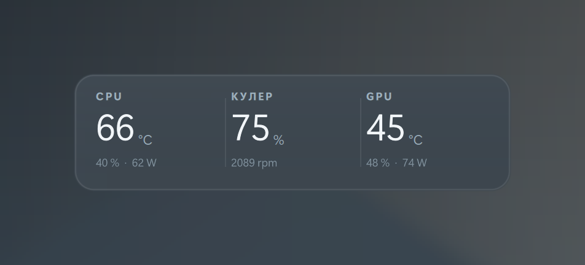

# Liquid Glass Sensors

Виджет рабочего стола Windows: температура CPU, ШИМ кулера (%), температура и загрузка GPU.
Акриловая панель в стиле Windows 11 с живым размытием фона.



## Установка

1. Скачайте `SensorsWidget-*.zip` из [Releases](https://github.com/Pe4enka41/SensorsWidget/releases/latest) и распакуйте.
2. Запустите `install.cmd` и подтвердите UAC.
3. Виджет появится на рабочем столе.

Требования: Windows 10/11 x64, Python 3.11+, видеокарта NVIDIA.

## Управление

- **ЛКМ** — перетащить; позиция запоминается.
- **ПКМ** — меню: зафиксировать положение, датчик кулера, тема, автозапуск, сброс позиции, выход.

## Если не работает

- CPU и кулер показывают «—» — нет прав администратора или драйвера PawnIO. Запустите `install.cmd` заново.
- GPU 0 % — вентиляторы видеокарты стоят до ~50 °C (полупассивное охлаждение).

## Удаление

Удалите папку программы, затем:

```powershell
schtasks /Delete /TN LiquidGlassSensors /F
```

Настройки: `%APPDATA%\LiquidGlassSensors`.
